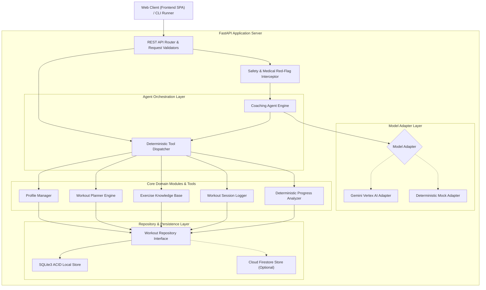

# Architecture & Technical Design: AI Workout Coach

**System Name:** AI Workout Coach  
**Architecture Style:** Modular Clean Architecture (Agent-First with Deterministic Domain Core)  
**Date:** 2026-10-13  
**Status:** Approved Technical Design  

---

## 1. System Architecture Diagram



---

## 2. Core Architectural Principles

1. **Deterministic Core, Probabilistic Guidance:**
   * Exercise searches, volume load calculations, 1-Rep Max estimations, database mutations, and safety constraints are written in **pure, deterministic Python**.
   * The Language Model is responsible for language understanding, contextual nuance, motivational encouragement, and tool invocation decisions.
2. **Pluggable Model Architecture:**
   * The agent communicates with an abstract `ModelAdapter`. Swapping between `Gemini 2.5 Flash`, `Gemini 3.8 Flash`, and `MockWorkoutCoachModelAdapter` requires no changes to workout domain logic.
3. **Repository Pattern for Storage:**
   * All mutations pass through an explicit `WorkoutRepository` interface. Local execution uses SQLite3 with full foreign-key constraints; Cloud execution can bind to Cloud Firestore.
4. **Defense-in-Depth Safety Guardrails:**
   * Explicit pre-model and post-model safety checks catch red-flag symptom statements and contraindication collisions before workout plans are committed or presented to users.

---

## 3. Component Decomposition

### 3.1. Profile Manager (`core/profile_manager.py`)
* Manages creation, retrieval, and validation of user profiles.
* Fields: user ID, fitness goal, experience level, available equipment, weekly frequency, target session duration, exercise preferences, and voluntary injury/limitation declarations.

### 3.2. Exercise Knowledge Base (`core/exercise_library.py`)
* Grounded catalog of 30+ fundamental compound and isolation movements.
* Attributes: id, name, category (push, pull, legs, core), movement pattern (squat, hinge, press, row, carry), target muscle groups, secondary muscles, required equipment, step-by-step technique cues, common pitfalls, approved regressions/substitutions, and contraindications.

### 3.3. Workout Planner Engine (`core/workout_planner.py`)
* Generates balanced multi-day training splits (Full Body, Upper/Lower, or Push/Pull/Legs).
* Enforces structural rules:
  * Compound movements before isolation movements.
  * Prescribes reps, sets, and rest intervals according to goal:
    * *Strength:* 3–5 sets of 3–6 reps, 2–3 mins rest.
    * *Hypertrophy:* 3–4 sets of 8–12 reps, 60–90s rest.
    * *Endurance / General Fitness:* 2–3 sets of 12–15 reps, 45–60s rest.
  * Injects targeted warm-up mobility and cooldown stretches.
  * Substitutes contraindicated exercises automatically with safe alternatives.

### 3.4. Workout Logger (`core/workout_logger.py`)
* Records completed sessions.
* Captures set-level telemetry: exercise ID, set index, weight (kg/lbs), repetitions, RPE, completed status, skipped flag, and qualitative user feedback.
* Enforces transactional integrity: logs are written to storage before confirmation is emitted.

### 3.5. Progress Analyzer (`core/progress_analyzer.py`)
* Performs pure mathematical evaluation of stored logs:
  * **Volume Load:** $V = \sum (\text{weight} \times \text{reps})$.
  * **Consistency / Adherence:** Ratio of completed planned workouts to target weekly frequency.
  * **Estimated 1RM (Epley Formula):** $\text{e1RM} = \text{weight} \times (1 + \frac{\text{reps}}{30})$ for reps $\le 10$.
  * **Overload Detection:** Compares consecutive sessions of the same exercise to verify progressive overload.
  * **Adjustment Engine:** Formulates rule-based recommendation (e.g., increase weight by 2.5kg if previous session RPE $\le 7$ across all sets).

### 3.6. Safety & Guardrail System (`core/safety.py`)
* Pre-flight text scanner for emergency/acute symptoms (e.g., chest pain, dizziness, tearing sensation).
* Plan validator: ensures every generated plan contains no exercises conflicting with the user's declared limitations.

### 3.7. Coaching Agent & Tool Dispatcher (`agent/coach.py`)
* Coordinates conversational state, intent classification, and tool execution.
* Exposes 9 required tool interfaces:
  1. `get_fitness_profile(user_id)`
  2. `update_fitness_profile(user_id, ...)`
  3. `create_workout_plan(user_id, goal, split_days, ...)`
  4. `get_current_workout_plan(user_id)`
  5. `search_exercises(query, category, equipment, avoid_contraindications)`
  6. `log_workout_session(user_id, workout_plan_id, session_data)`
  7. `get_workout_history(user_id, limit)`
  8. `calculate_progress(user_id, exercise_id)`
  9. `suggest_workout_adjustment(user_id, session_feedback)`

---

## 4. Database Schema (SQLite / Relational)

```sql
CREATE TABLE IF NOT EXISTS users (
    id TEXT PRIMARY KEY,
    name TEXT NOT NULL,
    created_at TIMESTAMP DEFAULT CURRENT_TIMESTAMP
);

CREATE TABLE IF NOT EXISTS fitness_profiles (
    user_id TEXT PRIMARY KEY,
    fitness_goal TEXT NOT NULL,
    experience_level TEXT NOT NULL,
    available_equipment TEXT NOT NULL, -- JSON array
    days_per_week INTEGER NOT NULL,
    session_duration_minutes INTEGER NOT NULL,
    preferences TEXT, -- JSON array
    limitations TEXT, -- JSON array
    updated_at TIMESTAMP DEFAULT CURRENT_TIMESTAMP,
    FOREIGN KEY(user_id) REFERENCES users(id) ON DELETE CASCADE
);

CREATE TABLE IF NOT EXISTS exercises (
    id TEXT PRIMARY KEY,
    name TEXT NOT NULL,
    category TEXT NOT NULL,
    movement_pattern TEXT NOT NULL,
    primary_muscles TEXT NOT NULL, -- JSON array
    secondary_muscles TEXT, -- JSON array
    equipment_required TEXT NOT NULL, -- JSON array
    instructions TEXT NOT NULL,
    substitutions TEXT, -- JSON array
    contraindications TEXT -- JSON array
);

CREATE TABLE IF NOT EXISTS workout_plans (
    id TEXT PRIMARY KEY,
    user_id TEXT NOT NULL,
    plan_name TEXT NOT NULL,
    goal TEXT NOT NULL,
    split_type TEXT NOT NULL,
    days_per_week INTEGER NOT NULL,
    is_active BOOLEAN DEFAULT 1,
    created_at TIMESTAMP DEFAULT CURRENT_TIMESTAMP,
    FOREIGN KEY(user_id) REFERENCES users(id) ON DELETE CASCADE
);

CREATE TABLE IF NOT EXISTS planned_sessions (
    id TEXT PRIMARY KEY,
    plan_id TEXT NOT NULL,
    day_number INTEGER NOT NULL,
    day_name TEXT NOT NULL,
    focus TEXT NOT NULL,
    FOREIGN KEY(plan_id) REFERENCES workout_plans(id) ON DELETE CASCADE
);

CREATE TABLE IF NOT EXISTS planned_exercises (
    id TEXT PRIMARY KEY,
    planned_session_id TEXT NOT NULL,
    exercise_id TEXT NOT NULL,
    order_in_session INTEGER NOT NULL,
    target_sets INTEGER NOT NULL,
    target_reps TEXT NOT NULL,
    rest_seconds INTEGER NOT NULL,
    notes TEXT,
    FOREIGN KEY(planned_session_id) REFERENCES planned_sessions(id) ON DELETE CASCADE,
    FOREIGN KEY(exercise_id) REFERENCES exercises(id)
);

CREATE TABLE IF NOT EXISTS completed_sessions (
    id TEXT PRIMARY KEY,
    user_id TEXT NOT NULL,
    plan_id TEXT,
    session_date DATE NOT NULL,
    duration_minutes INTEGER NOT NULL,
    perceived_effort_rpe INTEGER,
    feedback TEXT,
    created_at TIMESTAMP DEFAULT CURRENT_TIMESTAMP,
    FOREIGN KEY(user_id) REFERENCES users(id) ON DELETE CASCADE
);

CREATE TABLE IF NOT EXISTS completed_sets (
    id TEXT PRIMARY KEY,
    session_id TEXT NOT NULL,
    exercise_id TEXT NOT NULL,
    set_number INTEGER NOT NULL,
    weight_kg REAL NOT NULL,
    reps_performed INTEGER NOT NULL,
    rpe INTEGER,
    is_completed BOOLEAN DEFAULT 1,
    FOREIGN KEY(session_id) REFERENCES completed_sessions(id) ON DELETE CASCADE,
    FOREIGN KEY(exercise_id) REFERENCES exercises(id)
);

CREATE TABLE IF NOT EXISTS chat_messages (
    id TEXT PRIMARY KEY,
    user_id TEXT NOT NULL,
    role TEXT NOT NULL,
    content TEXT NOT NULL,
    tool_calls TEXT, -- JSON string
    created_at TIMESTAMP DEFAULT CURRENT_TIMESTAMP,
    FOREIGN KEY(user_id) REFERENCES users(id) ON DELETE CASCADE
);
```

---

## 5. API Specification & Endpoints

| HTTP Method | Path | Request Body | Response Description |
|---|---|---|---|
| `GET` | `/api/v1/health` | None | System status and active model adapter type |
| `POST` | `/api/v1/profiles` | `ProfileCreateSchema` | Created user fitness profile |
| `GET` | `/api/v1/profiles/{user_id}` | None | Current user fitness profile |
| `PATCH` | `/api/v1/profiles/{user_id}` | `ProfileUpdateSchema` | Updated user fitness profile |
| `GET` | `/api/v1/exercises` | Query params: `equipment`, `category`, `avoid` | Filtered list of exercises |
| `POST` | `/api/v1/workout-plans` | `PlanGenerateRequestSchema` | Generated and validated workout plan |
| `GET` | `/api/v1/workout-plans/{user_id}/current` | None | User's active workout plan |
| `POST` | `/api/v1/workout-sessions` | `SessionLogSchema` | Recorded workout session and calculated volume |
| `GET` | `/api/v1/workout-history/{user_id}` | Query param: `limit` | Chronological list of completed sessions |
| `GET` | `/api/v1/progress/{user_id}` | Query param: `exercise_id` | Adherence, volume load, and 1RM trends |
| `POST` | `/api/v1/coach/chat` | `ChatTurnRequestSchema` | Conversational response + executed tool actions |

---

## 6. Security and Privacy Boundaries

1. **User Isolation:** All queries filter strictly by authenticated `user_id`. One user cannot read or overwrite another's logs or profile.
2. **Zero Sensitive Data in Prompts:** Secrets, API credentials, and internal system paths are strictly excluded from logging and prompts.
3. **Audit Logging:** System logs model queries, tool parameters, and execution latency with sensitive tokens masked.
