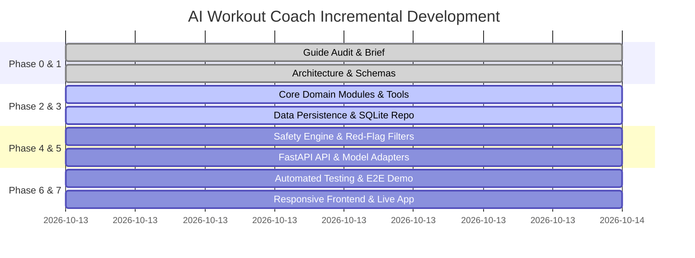

# Implementation Plan: AI Workout Coach Prototype

**System:** AI Workout Coach (`ai-workout-coach`)  
**Methodology:** Incremental Agent-First Development  
**Date:** 2026-10-13  
**Status:** In Progress (Phases 0–1 Complete, Entering Phase 2)  

---

## 1. Phase Breakdown & Execution Sequence

---

## 2. Detailed Milestone Deliverables

### Milestone 1: Core Domain, Exercise Catalog & Persistence (Phases 2 & 3)
* **Directory:** `workout_coach/`
  * `core/models.py`: Pydantic V2 data schemas for Users, Profiles, Exercises, Plans, Sessions, Sets, Feedback, Progress.
  * `core/exercise_library.py`: Grounded repository of 30+ exercises categorized by mechanics, target muscles, equipment, cues, regressions, and contraindications.
  * `core/db.py`: SQLite connection manager, transactional schema creation, and seeding script.
  * `core/repository.py`: CRUD operations for user profiles, exercise queries, plans, session logs, and sets.
  * `core/progress_analyzer.py`: Deterministic fitness arithmetic (Volume calculation, Epley e1RM formula, adherence ratios, overload tracking).
  * `core/workout_planner.py`: Algorithmic workout split generator adhering to equipment, frequency, and contraindication constraints.
  * `core/safety.py`: Red-flag symptom detector and contraindication verifier.
* **Verification:** Unit tests verifying database creation, seed insertion, and mathematical consistency.

---

### Milestone 2: Agent Tools & Model Adapter Layer (Phases 2, 4 & 5)
* **Directory:** `workout_coach/agent/`
  * `agent/tools.py`: The 9 callable typed tools with input validation and explicit persistence:
    1. `get_fitness_profile`
    2. `update_fitness_profile`
    3. `create_workout_plan`
    4. `get_current_workout_plan`
    5. `search_exercises`
    6. `log_workout_session`
    7. `get_workout_history`
    8. `calculate_progress`
    9. `suggest_workout_adjustment`
  * `agent/model_adapter.py`: Abstract `BaseModelAdapter`, `MockWorkoutCoachModelAdapter` (deterministic offline testing), and `GeminiVertexModelAdapter` (live Vertex AI Gemini 2.5/3.8 Flash).
  * `agent/coach.py`: Orchestrator connecting model responses, tool dispatching, conversational state, and safety filters.
* **Verification:** Tests executing all 9 tools directly and through the agent orchestrator.

---

### Milestone 3: FastAPI Backend & API Contracts (Phase 5)
* **Directory:** `workout_coach/api/`
  * `api/main.py`: FastAPI server exposing routes:
    * `GET /api/v1/health`
    * `POST /api/v1/profiles`
    * `GET /api/v1/profiles/{user_id}`
    * `PATCH /api/v1/profiles/{user_id}`
    * `GET /api/v1/exercises`
    * `POST /api/v1/workout-plans`
    * `GET /api/v1/workout-plans/{user_id}/current`
    * `POST /api/v1/workout-sessions`
    * `GET /api/v1/workout-history/{user_id}`
    * `GET /api/v1/progress/{user_id}`
    * `POST /api/v1/coach/chat`
  * Static file mount for frontend delivery.
* **Verification:** FastAPI test client running end-to-end HTTP request validation.

---

### Milestone 4: Automated Test Suite & E2E Verification (Phase 6)
* **Directory:** `tests/`
  * `test_models_and_db.py`: Schema validation, database constraints, isolation.
  * `test_exercise_library.py`: Exercise searching, equipment filtering, contraindication exclusions.
  * `test_workout_planner.py`: Multi-day split logic, volume limits, safety rules.
  * `test_progress_analyzer.py`: Volume math, adherence percentages, e1RM calculations.
  * `test_safety.py`: Interception of emergency symptoms (chest pain, dizziness) and exclusion of unsafe exercises.
  * `test_agent_tools.py`: Tool calling, parameter validation, transactional persistence.
  * `test_api.py`: FastAPI endpoint tests.
  * `test_e2e_journey.py`: Full user journey (Profile $\rightarrow$ Plan $\rightarrow$ Log $\rightarrow$ Progress $\rightarrow$ Adaptive Adjustment).
* **CLI Demo Script:** `demo_cli.py` showcasing the full coach workflow in a standalone terminal run.

---

### Milestone 5: Web Frontend (Phase 7)
* **Directory:** `workout_coach/static/`
  * `index.html`: Clean, responsive modern dashboard:
    * Fitness Profile Onboarding / Editor.
    * Today's Workout & Active Plan Viewer.
    * Interactive Workout Logger (set-by-set weight & rep inputs).
    * Progress & Volume Charts.
    * Conversational Coach Dialogue panel with action chips.
  * `styles.css`: Material 3 / Google Sans styling matching the workshop aesthetics.
  * `app.js`: Async REST client communicating directly with the FastAPI backend.
* **Verification:** Browser end-to-end manual and headless verification.

---

## 3. Definition of Done Checklist

- [x] Phase 0: Lab guide researched, resources audited (`docs/guide-audit.md`).
- [x] Phase 1: Product brief, requirements, architecture, and plan published (`docs/project-brief.md`, `docs/architecture.md`, `docs/implementation-plan.md`).
- [ ] Phase 2: Core workout-coaching agent, 9 callable tools, and domain modules implemented.
- [ ] Phase 3: SQLite persistence, schema, seed data, and repository operations verified.
- [ ] Phase 4: Safety guardrails, contraindication suppression, and red-flag interceptors verified.
- [ ] Phase 5: FastAPI REST endpoints, request validators, and model adapters implemented.
- [ ] Phase 6: Full automated test suite passing (100% deterministic test coverage).
- [ ] Phase 7: Clean web frontend connected to the backend, working locally and ready for deployment.
